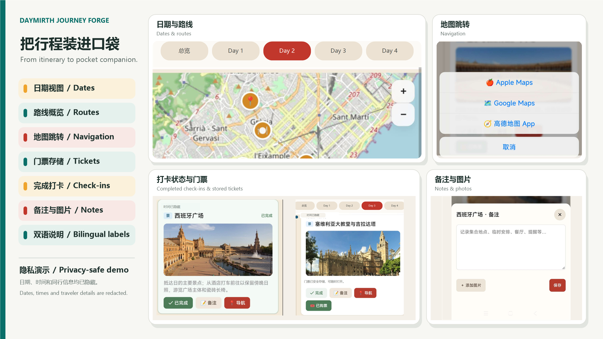

# DayMirth Journey Forge

[English](README.md) | [简体中文](README.zh-CN.md)

**Turn a confirmed itinerary into a polished, installable travel companion from one Codex conversation.**

DayMirth Journey Forge is an open-source Codex Skill that combines daily routes, maps, navigation, tickets, check-ins, notes, reminders and offline records into an Android app or iPhone-installable PWA.

> This Skill runs on a computer in Codex/Agent. The generated app is used on the phone; the Skill itself is not a mobile app.

<p align="center">
  
</p>

<p align="center"><em>Showcase assembled from the finished App. Dates, times and traveler details have been removed or replaced; no ticket files, QR codes or booking credentials are shown.</em></p>

## What it creates

- Daily timelines, visit-order maps and one-tap external navigation.
- PDF/JPG/PNG ticket access with any practical number of travelers, documents and pages.
- Persistent check-ins, text notes, up to six note images per event, and JSON backup/restore.
- Reservation and caution notices, graceful missing-data layouts, and scoped offline storage.
- Proactively researched landmark photos with license records; user images always take priority.
- A complete interactive preview before approval, followed by Android/PWA packaging and a platform-specific phone guide.

Map lines show visit order, not live traffic or shortest-path routing. Maps and external navigation require a network connection.

## 60-second install

Requirements: desktop Codex, Git, and Python 3.9 or newer.

### Windows PowerShell

```powershell
$skillDir = Join-Path $env:USERPROFILE ".codex\skills\daymirth-journey-forge"
git clone https://github.com/kskbl-0714/daymirth-journey-forge.git $skillDir
python -m pip install -r (Join-Path $skillDir "requirements.txt")
```

### macOS / Linux

```bash
skill_dir="${CODEX_HOME:-$HOME/.codex}/skills/daymirth-journey-forge"
git clone https://github.com/kskbl-0714/daymirth-journey-forge.git "$skill_dir"
python3 -m pip install -r "$skill_dir/requirements.txt"
```

Alternatively, download the repository ZIP and place the extracted `daymirth-journey-forge` folder directly inside the Codex `skills` directory. Restart or reload Codex after installation.

## Use it

Invoke the Skill explicitly with `$daymirth-journey-forge`; automatic discovery is also enabled.

```text
Use $daymirth-journey-forge to turn my confirmed itinerary into an Android travel app.
Use the tickets and images I already shared in this conversation. Show me the complete preview before packaging.
```

For the most accurate result, confirm daily plans, attraction order, transport and purchased reservation times before invoking the Skill. It reuses the current conversation, summarizes known information, asks material missing choices together, and always gives a fallback for optional inputs.

```text
Itinerary and tickets -> confirm key choices -> research/match media
-> build complete preview -> collect one feedback batch -> verify -> package
```

## Inputs and fallbacks

| Input | Best supplied by the user | Fallback when omitted |
|---|---|---|
| Itinerary | Destination, dates, order, fixed bookings | At least a destination/travel intent; Day 1/2 and periods/order for unknown dates/times |
| Phone | Android, iPhone or both | Validated PWA plus Android attempt when the toolchain is available |
| Map/navigation | Embedded map and external app preference | OpenStreetMap plus the device chooser |
| App name | Chinese or English name | `TripPocket` |
| Tickets | PDF/JPG/PNG and traveler/event associations | Hide ticket controls or import locally inside the generated app |
| Cover/landmarks | User-selected media takes priority | Search verified reusable real photos, then disclose gaps and use supplied media, labeled contextual artwork or a no-image layout |
| Daily fun images | User image pool or explicit mapping | Ask whether to generate them with AI or remove the section |

Theme color and subtitle are derived automatically instead of becoming extra questions. Explicit changes made during preview confirmation still win.

## Platform outputs

| Target | Default output | Requirements and boundary |
|---|---|---|
| Android | Source, signed APK, SHA-256 and verification report | JDK 17, Android SDK 35 and build-tools 35.0.0 for APK packaging |
| iPhone | HTTPS PWA that can be added to the Home Screen | Safari plus private/public HTTPS hosting; this is not an IPA |
| Native iOS | Conditional IPA/native project | macOS, Xcode, provisioning and Apple signing; never promised from Windows |

If a native toolchain is unavailable, the Skill still delivers the validated PWA, native source, diagnostics and an exact continuation command. It never labels an unbuilt APK/IPA as complete.

## Try the fictional demo

```powershell
python scripts/create_demo_assets.py
python scripts/validate_trip.py examples/fictional-trip/trip.json --assets-root examples/fictional-trip
python scripts/build_app.py examples/fictional-trip/trip.json --input-root examples/fictional-trip --output ../daymirth-demo --embed-private-tickets
python scripts/verify_output.py ../daymirth-demo/web
python -m http.server 8000 --directory ../daymirth-demo/web
```

Open `http://localhost:8000`. The demo itinerary and travelers are fictional, its artwork is original and redistributable, and its ticket is visibly invalid.

Android packaging prerequisites, direct-SDK fallback and release signing are documented in [references/platforms.md](references/platforms.md).

## Validation and privacy

```powershell
python scripts/self_test.py
python scripts/public_release_check.py .
```

The tests cover arbitrary traveler/ticket counts, private-ticket exclusion, path and HTML boundaries, minimal inputs, stable IDs and generated-output completeness. GitHub Actions runs the portable validation suite on every push and pull request.

Never commit real tickets, QR codes, traveler details, private photos, signing keys or private generated builds. APK assets can be extracted, and a publicly hosted PWA is not private storage. Keep private inputs/outputs outside this repository and visually review every release.

Leaflet, PDF.js, OpenStreetMap data and searched travel media retain their own licenses and attribution requirements. Original code, templates and demo artwork use the MIT license.

## Repository layout

```text
SKILL.md                 Skill entry point and decision rules
agents/openai.yaml       Codex display metadata and invocation policy
assets/                  Web/Android templates and README screenshots
examples/fictional-trip  Redistributable public demo
references/              Workflow, schema, media/privacy and platform details
scripts/                 Validation, generation, APK build and packaging tools
```

## Package a public copy

```powershell
python scripts/public_release_check.py .
python scripts/package_skill.py ../outputs/daymirth-journey-forge-github.zip
```

The archive excludes caches, private outputs, APKs and signing material, verifies its own ZIP integrity, and writes a companion SHA-256 file. No script creates or pushes a remote repository.

## License

MIT. See [LICENSE](LICENSE) and the third-party license files under `assets/web/vendor`.
